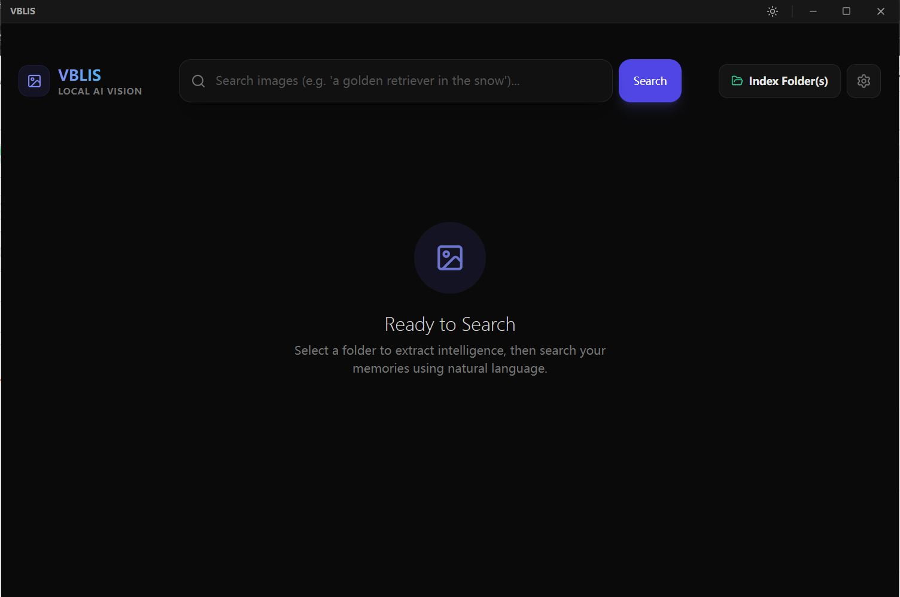

# VBLIS-vlm-based-local-image-search

> [!WARNING]
> A large portion of the code for this software is AI-generated, guided and supervised by human input, and manually tested.

VBLIS is a powerful, privacy-focused local image search application that uses advanced Vision-Language Models (VLMs) like SigLIP-2 and CLIP to index and search your local image library semantically.

## Features

- **Semantic Search**: Search your images using natural language (e.g., "sunset at the beach" or "a cat sitting on a laptop").
- **Image-to-Image Search**: Find similar images by uploading or dragging an image into the search bar.
- **Local Indexing**: Rapidly index large folders of images locally. All data stays on your machine.
- **Index Caching**: The index is cached on disk and can be refreshed or removed in the settings. Thumbnails are also cached for faster loading.
- **Multiple Model Support**: Choose between high-performance models like `google/siglip2-base-patch16-224` and `openai/clip-vit-base-patch32`.
- **GPU Acceleration**: Built-in support for NVIDIA GPUs via CUDA for lightning-fast inference.
- **HEIC/HEIF Support**: Full support for modern image formats commonly used on high-end cameras and iPhones.
- **Dark & Light Mode**: A sleek, modern interface that adjusts to your preference.

## How to Use

1. **Download & Install**: Download the latest `VBLIS-Setup-0.0.1.exe` from the Releases page and install it.
Or use the portable version `VBLIS-win-0.0.1.zip`, unzip the zip file and launch the software via `VBLIS.exe`.
2. **Select a Model**: On first launch, go to the model selection screen and download your preferred model (`siglip2` is highly recommended).
3. **Add Folders**: Click the "Index Folders" button or drag and drop folders into the app to start indexing your image library. VBLIS will index all the subfolders in the given directory.
4. **Search**: Once indexing is complete, type a query in the search bar or drag an image into the search area to find what you're looking for.
> [!TIP]
> VBLIS partially supports search while indexing. You can search while the app is indexing your folders, but the results will be limited to the images that have been indexed so far.
5. **GPU Settings**: If you have an NVIDIA GPU, ensure GPU acceleration is enabled in the settings for optimal performance.
6. **Result Filtering**: You can adjust the number of results to display and the minimum matching score in the settings.
7. **Model Management**: You can download, switch, and delete models in the settings.
8. **Index and Cache Management**: You can clear the index and cache in the settings.

## TODO / Roadmap

- [ ] Support for more Vision-Language Models.
- [ ] Enhanced GPU acceleration settings (quantization, memory management).
- [ ] Support for non-NVIDIA GPUs (MPS for Mac, Vulkan/DirectML for AMD/Intel).
- [ ] Advanced filtering (by date, folder, or image properties).
- [ ] Image-to-Video searching.

