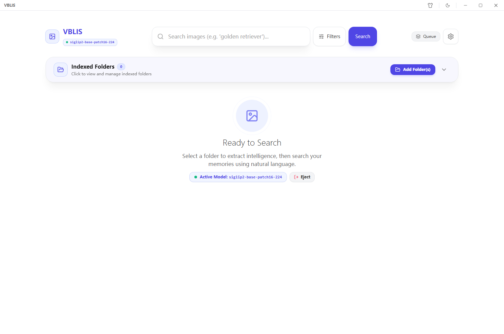

# VBLIS-vlm-based-local-image-search

> [!WARNING]
> A large portion of the code for this software is AI-generated, guided and supervised by human input, and manually tested.

VBLIS is a powerful, privacy-focused local image search application that uses advanced Vision-Language Models (VLMs) like SigLIP-2 and CLIP to index and search your local image and video library semantically.

## Features

- **Semantic Search**: Search your images and videos using natural language (e.g., "sunset at the beach" or "a cat sitting on a laptop").
- **Image-to-Image Search**: Find similar images by uploading or dragging an image into the search bar.
- **Video Search**: Videos are searched by their frames. Each video counts as one result and brings its best-matching frames; **Find more frames** shows the rest. Videos recorded in portrait on a phone are shown and searched upright.
- **Search Filters**: Narrow any search to images or videos, chosen folders, a date range, orientation, file format or a minimum resolution.
- **Meaningful Scores**: With SigLIP models, a text search shows how sure the model is that a result fits your words; an image search shows how visually close each result is.
- **Local Indexing**: Rapidly index large folders of images and videos locally. All data stays on your machine.
- **Fast Re-sync**: Re-syncing a folder only processes new or changed files, so an unchanged folder is checked in a fraction of a second.
- **Index Caching**: The index is cached on disk and can be refreshed or removed in the settings. Thumbnails are also cached for faster loading.
- **Multiple Model Support**: Choose between SigLIP 2 and CLIP models (see [Models](#models)).
- **GPU Acceleration**: Built-in support for NVIDIA GPUs via CUDA for fast inference. Without one, VBLIS runs on the CPU.
- **HEIC/HEIF and AVIF Support**: Full support for modern image formats commonly used on high-end cameras, iPhones and the web.
- **Two Interface Styles**: A modern style and a terminal style, each in dark and light mode.

## System Requirements

- Windows 10 or 11, 64-bit.
- An NVIDIA GPU is optional: VBLIS uses it through CUDA when one is available and runs on the CPU otherwise (indexing is slower).
- Disk space: about 4.5 GB for the app, plus 0.6–4.3 GB for each downloaded model, plus the index and the thumbnail cache.

## Supported Formats

- **Images:** JPEG, PNG, WebP, BMP, HEIC/HEIF, AVIF
- **Videos:** MP4, M4V, MOV, MKV, AVI, WebM

## Models

| Model | Size | Good for |
|---|---|---|
| `google/siglip2-so400m-patch16-naflex` | 4.3 GB | The best results; recommended with an NVIDIA GPU |
| `google/siglip2-so400m-patch14-384` | 4.3 GB | The same size, with a fixed square input |
| `google/siglip2-base-patch16-naflex` | 1.5 GB | CPU or smaller GPUs |
| `google/siglip2-base-patch16-224` | 1.5 GB | CPU or smaller GPUs, with a fixed square input |
| `openai/clip-vit-base-patch32` | 0.6 GB | The lightest option |

The `naflex` models look at each image in its own aspect ratio; the others resize it to a square first. Each model keeps its own index, so after switching to another model, index your folders again for it.

## How to Use

1. **Download & Install**: From the [Releases](https://github.com/opoeci6/VBLIS-vlm-based-local-image-search/releases) page, download the latest `VBLIS-Setup-<version>.exe` and run it.
Or use the portable version `VBLIS-<version>-win.7z`: extract it with [7-Zip](https://www.7-zip.org/) (or the extraction built into Windows 11) into a folder you can write to, not Program Files, and launch `VBLIS.exe`.
> [!NOTE]
> The installer isn't code-signed, so Windows SmartScreen may show "Windows protected your PC". Click **More info**, then **Run anyway**. To check a download, compare the output of `Get-FileHash <file>` in PowerShell with its line in the release's `SHA256SUMS.txt`.
2. **Select a Model**: On first launch, choose a model and download it (a SigLIP 2 model is highly recommended; see [Models](#models)).
3. **Add Folders**: Click **Add Folder(s)** or drag and drop folders into the app to start indexing your library. VBLIS indexes all the subfolders of each folder.
4. **Search**: Once indexing is complete, type a query in the search bar or drag an image into the search area to find what you're looking for.
> [!TIP]
> VBLIS partially supports search while indexing. You can search while the app is indexing your folders, but the results will be limited to the images that have been indexed so far.
5. **GPU Settings**: If you have an NVIDIA GPU, ensure GPU acceleration is enabled in the settings for optimal performance.
6. **Result Filtering**: In the settings you can adjust how many results to display (a video counts as one result and brings its best frames; open it and use **Find more frames** to see all of its matching frames) and two minimums: a **match score** for text searches (with SigLIP models, how sure the model is that a result fits your words) and a **similarity** for image searches (how visually close a result is to the dropped image).
7. **Search Filters**: The **Filters** button next to the search bar narrows any search to images or videos, chosen folders, a date range (the date a photo or video was taken, or the file's modified date when it has none), orientation, file format and a minimum resolution. Changing a filter updates the current results right away. Date, orientation and resolution come from media details that VBLIS reads while indexing; for folders indexed with an older version, use **Read details now** in the Filters panel.
8. **Model Management**: You can download, switch, and delete models in the settings.
9. **Index and Cache Management**: You can clear the index and cache in the settings.

## Upgrading

- Your index, downloaded models and settings are kept. The installer keeps them in `%LOCALAPPDATA%\VBLIS`, and the portable version in the `VBLIS-data` folder next to `VBLIS.exe`. When you install over an older version, its data is moved there automatically.
- After upgrading from v0.2.0 or older, re-sync your folders once (the **Re-sync** button of each folder in the Indexed Folders panel). That picks up AVIF files, and turns portrait videos and photos that older versions indexed sideways upright. Only those files are embedded again.
- The date, orientation and resolution filters need media details that older versions didn't read. VBLIS reads them in the background the first time you open the Filters panel; no re-indexing is needed.

## TODO / Roadmap

- [x] Support for more Vision-Language Models.
- [x] Enhanced GPU acceleration settings (quantization, memory management).
- [ ] Support for non-NVIDIA GPUs (MPS for Mac, Vulkan/DirectML for AMD/Intel).
- [ ] Interface translations (i18n).
- [ ] Browse the library without a search query.
- [ ] Place names and a location filter, from the GPS data in photos and videos.
- [x] Advanced filtering (by date, folder, or image properties).
- [x] Image-to-Video searching.
